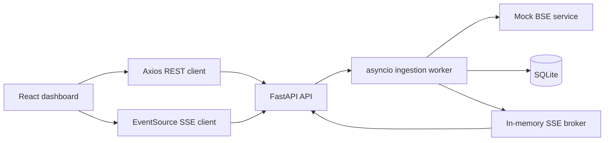

# ARHAM Fintech architecture

## Request flow

1. The dashboard loads trades and statistics through REST.
2. `POST /api/trades/pull` creates a pending job and returns HTTP 202.
3. The worker marks the job running, fetches mock BSE records, and saves only
   new trade IDs.
4. After the database commit, the worker publishes `ingestion.completed` or
   `ingestion.failed`.
5. Connected dashboards receive the event and reload authoritative REST data.

## Reliability behavior

- Trade IDs are unique in SQLite and duplicate records are skipped before insert.
- SSE events carry IDs and retain the latest 100 events in process.
- Browsers reconnect automatically; `Last-Event-ID` allows recent event replay.
- Each worker task uses its own SQLAlchemy session.

## Assessment scope

The worker and SSE broker are deliberately in-process. A production deployment
would replace them with durable, shared infrastructure before running multiple
API instances.
